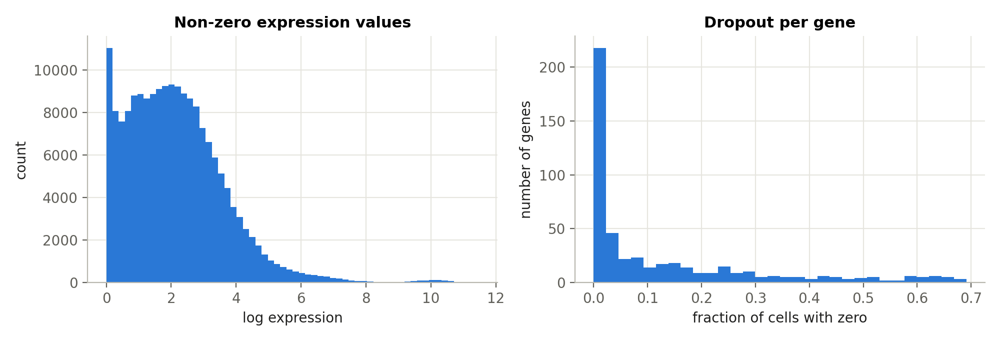
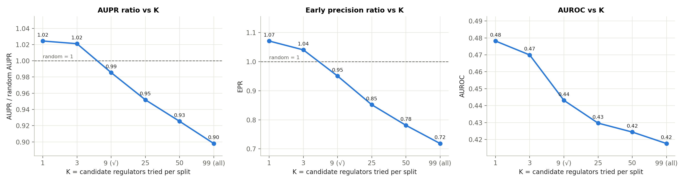
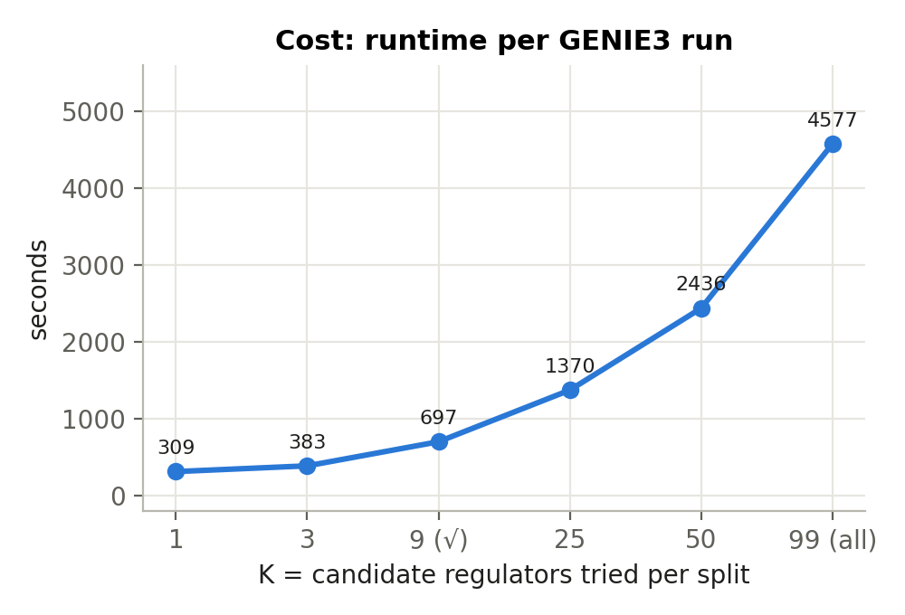
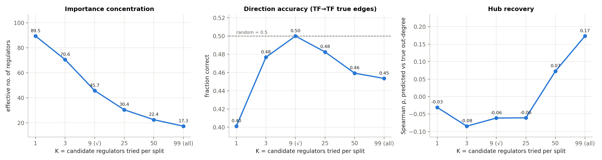
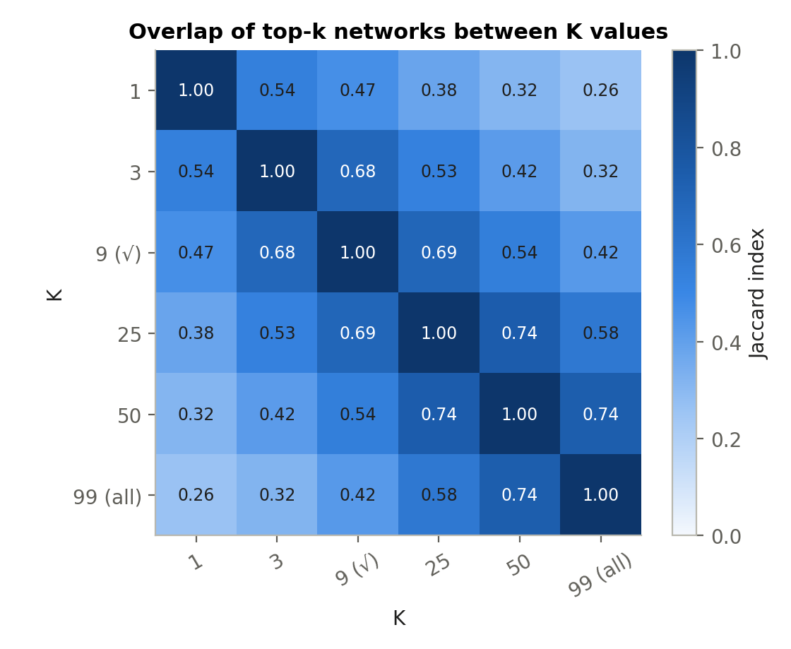
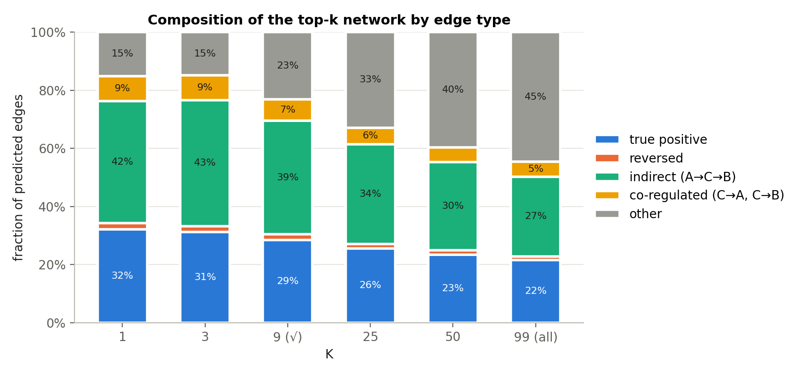
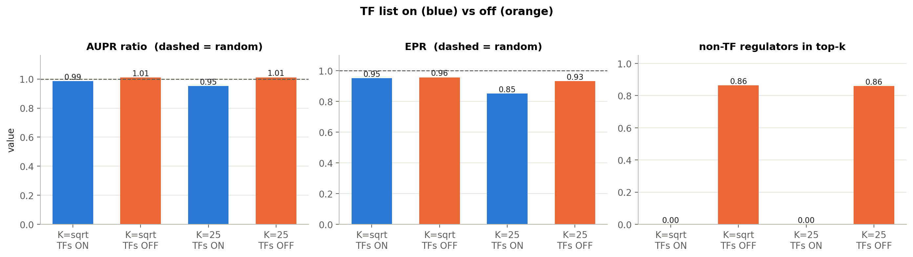
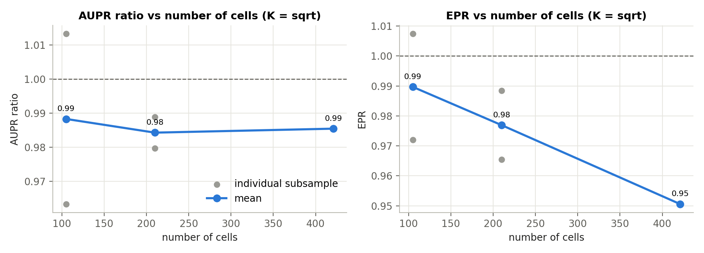
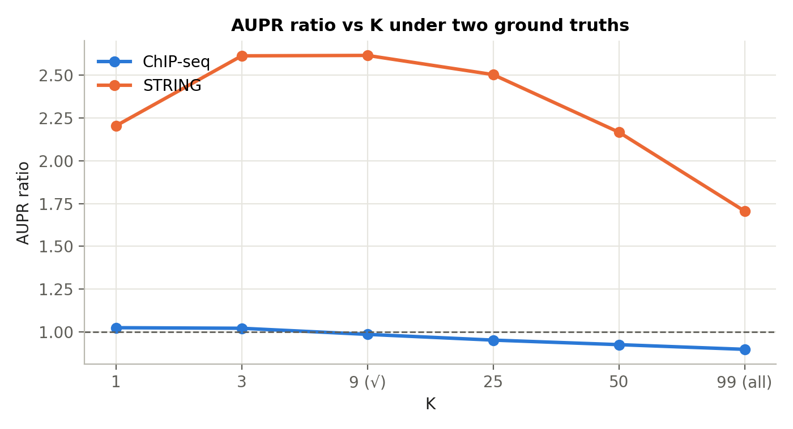

# Directed GRN inference with GENIE3 on real single-cell data: effect of *K* and of prior TF knowledge

**CB 5313 Systems Biology & Network Modeling — Course Project, Topic 6 (Directed GRN inference, GENIE3)**

## Research question

> *How do the Random Forest parameter K and prior transcription-factor (TF) knowledge affect the accuracy and structure of gene regulatory networks inferred by GENIE3 from real single-cell RNA-seq data?*

GENIE3 (Huynh-Thu et al., 2010) infers a directed gene regulatory network by training one Random Forest per gene, predicting that gene's expression from the expression of candidate regulators. Each regulator's variance-reduction importance becomes the weight of the edge *regulator → target*. The parameter **K** (`max_features`) sets how many randomly chosen candidate regulators each tree split can choose from. The paper tested only K = √p and K = all, on simulated (DREAM4) and bulk microarray (*E. coli*) data.

This project applies GENIE3 to **real single-cell data**. On that one dataset it changes four things:

1. **K**: 1, 3, √ (9), 25, 50, all (99)
2. **TF list** on vs off: does prior knowledge of which genes are regulators matter?
3. **Number of cells**: 25 %, 50 %, 100 %
4. **A comparison** with a correlation network, a method from the course

---

## Data

| | |
|---|---|
| **Expression data** | Mouse embryonic stem cells (mESC), single-cell RNA-seq (RamDA-seq) of **421 cells** collected at 0, 12, 24, 48 and 72 h of differentiation (Hayashi et al., 2018; GEO GSE98664), as processed by the **BEELINE** benchmark (Pratapa et al., 2020) |
| **Ground truth 1** | BEELINE's cell-type-specific **mESC ChIP-seq network**: TF → target edges supported by ChIP-seq binding (4,853 edges within the selected genes) |
| **Ground truth 2** | BEELINE's mouse **STRING network**: functional associations |
| **TF list** | BEELINE's mouse TF list |
| **Source** | Zenodo, doi:[10.5281/zenodo.3701939](https://doi.org/10.5281/zenodo.3701939) (version 3, licence CC BY-NC 4.0), files `BEELINE-data.zip` and `BEELINE-Networks.zip` |

This dataset is different from the GENIE3 package's tutorial data (`data.txt`, 10 genes × 136 conditions) and from the paper's datasets (simulated DREAM4 and *E. coli* microarrays).

**Raw data is not stored in this repository.** `download_data.py` downloads it from Zenodo, checks the published MD5 checksums, and extracts only the files used.

### Gene selection

Gene selection follows BEELINE's `generateExpInputs.py`:

1. Keep genes that vary significantly over pseudotime (`VGAMpValue` < 0.01, Bonferroni-corrected). This leaves 8,150 of 18,385 genes, including 620 TFs.
2. Keep the **100 most variable TFs** and the **400 most variable non-TF genes**, giving **500 genes**. 12.9 % of the values in the final matrix are zero (dropout).

BEELINE's standard setting keeps all 620 significant TFs plus 500 genes. With 620 candidate regulators, a single GENIE3 run at K = all would take several hours on a free Colab CPU, which made a K sweep infeasible. The selection criterion (variance) is the same as BEELINE's. Gene symbols are converted to upper case before matching, because the expression file uses mouse-style symbols (`Sparc`) while the networks use upper case (`ADNP`).

### Evaluation

Only **27 of the 100 TFs** were profiled by ChIP-seq: CBX7, EED, ESRRB, GATA4, JARID2, KDM5B, KLF2, KLF4, MTF2, MYC, MYCN, NANOG, NFYA, NR0B1, NRF1, PARP1, PHC1, POU5F1, SOX17, SOX2, SUZ12, TBX3, TGIF1, TRIM28, UTF1, ZFP42 and ZIC3. The largest ChIP-seq hubs are NANOG (352 targets), UTF1 (339) and POU5F1 (326). Edges from TFs without ChIP-seq data are *unknown*, not false, so accuracy is computed only on edges from these 27 TFs to all other genes: 13,473 scored edges, of which 30 % are true. This follows BEELINE's metrics:

- **AUPR ratio** = AUPR / edge density, where the density is the AUPR of a random predictor. 1 = random.
- **EPR** (early precision ratio) = precision of the top-*k* edges / density, with *k* = number of true edges.
- **AUROC**: 0.5 = random.

Because the ChIP-seq network is dense (density 0.30), the highest possible AUPR ratio is only about 3.3. For STRING (density 0.016) it is about 63.

---

## How to run

1. Open `GENIE3_K_sweep_BEELINE_mESC.ipynb` in Google Colab (*File → Upload notebook*).
2. Optionally set `USE_DRIVE = True` in the configuration cell. GENIE3 results are then cached in Google Drive and survive a runtime reset.
3. Choose *Runtime → Run all*.

The notebook downloads the data (about 280 MB), runs every analysis, saves all tables and figures to `results/`, and downloads `genie3_beeline_results.zip`.

**Runtime:** about **3–3.5 hours** on a free Colab CPU runtime with the default 300 trees. K = all alone takes about 76 minutes. For a quick test, set `NTREES = 50`.

To run outside Colab:

```bash
pip install -r requirements.txt
python download_data.py data          # downloads and extracts the data into ./data
jupyter notebook GENIE3_K_sweep_BEELINE_mESC.ipynb
```

`requirements.txt` lists the package versions used (the Colab defaults at the time of the run).

### Repository structure

```
├── README.md
├── GENIE3_K_sweep_BEELINE_mESC.ipynb   # all code, commented
├── download_data.py                      # downloads the BEELINE data from Zenodo
├── requirements.txt                      # package versions
└── results/
    ├── fig0_data_overview.png … fig7_chip_vs_string.png
    ├── summary_K_sweep.csv               # accuracy, structure and error types per K
    ├── tf_list_on_off.csv
    ├── cell_subsampling.csv
    ├── genie3_vs_correlation.csv
    ├── chip_vs_string.csv
    ├── top30_edges_K1.csv
    └── gene_set.csv                      # the 500 genes, TF status, ChIP-seq status
```

---

## Method: GENIE3 implementation

The implementation adapts the Random Forest procedure in the original GENIE3 Python code ([vahuynh/GENIE3](https://github.com/vahuynh/GENIE3), `GENIE3_python/GENIE3.py`). The importance computation (unnormalised variance reduction averaged over trees) and the unit-variance normalisation of each target are unchanged. Changes from the original:

| Original | This project | Reason |
|---|---|---|
| `max_features = "auto"` for K = all | `max_features = None` | `"auto"` was removed in scikit-learn 1.3; `None` gives the same behaviour |
| no `random_state` | fixed seed per target | reproducibility |
| `multiprocessing.Pool` | `n_jobs=-1` inside each forest | `Pool` is unreliable in notebooks; same result |
| — | skip targets with zero variance | a gene that is zero in every cell cannot be normalised |

Settings: 300 trees per forest (the paper used 1000; the notebook checks how stable the ranking is), seed 0, TF list = the 100 selected TFs unless stated otherwise.

**Implementation checks** (notebook Section 6):
- The importances for a target sum to 0.998, close to the expected 1 (the variance of the normalised target, Eq. 4 of the paper).
- The rankings from 300 trees and 1000 trees agree closely: mean Spearman ρ = 0.945 (minimum 0.931) over 5 targets.

---

## Results

### Expected outcome (before running)

Based on the original GENIE3 paper and my DREAM4 results, I expected larger K values to improve network inference, as the model would have more candidate regulators to choose from at each split. I also expected the known TF list to improve predictions by excluding unlikely regulators, and more cells to provide better estimates of gene expression relationships.

However, I expected the real mESC data to be more challenging than DREAM4 because of expression noise, dropout and differences in cell state during differentiation.



### 1. Effect of K on accuracy



| K | 1 | 3 | 9 (√) | 25 | 50 | 99 (all) |
|---|---|---|---|---|---|---|
| AUPR ratio (ChIP-seq) | **1.02** | 1.02 | 0.99 | 0.95 | 0.93 | 0.90 |
| EPR (ChIP-seq) | **1.07** | 1.04 | 0.95 | 0.85 | 0.78 | 0.72 |
| AUROC (ChIP-seq) | **0.48** | 0.47 | 0.44 | 0.43 | 0.42 | 0.42 |
| Runtime (s) | 309 | 383 | 697 | 1,370 | 2,436 | 4,577 |



**Permutation test.** Shuffling the scores 200 times gives a random AUPR of 0.301 (99th percentile 0.309). No K setting exceeds the 99th percentile: the best, K = 1, reaches 0.308.

**Interpretation.**

The results were different from DREAM4. Against the ChIP-seq reference, the AUPR ratio decreased from 1.024 at K=1 to 0.898 at K=99. Since a ratio of 1 represents random-ranking performance, none of the K settings showed a meaningful improvement over random.

AUROC also decreased from 0.478 to 0.418. This suggests that allowing more candidate regulators at each split did not help recover ChIP-seq interactions.

Unlike DREAM4, where larger K performed better, the smallest K gave the highest ChIP-seq score. However, the differences between settings were small compared with the overall lack of predictive performance. I would therefore not consider K=1 a reliably better setting without further testing.

### 2. Effect of K on network structure



| K | 1 | 3 | 9 (√) | 25 | 50 | 99 (all) |
|---|---|---|---|---|---|---|
| Effective regulators per target | 89.5 | 70.6 | 45.7 | 30.4 | 22.4 | 17.3 |
| Direction accuracy (TF→TF edges, random = 0.5) | 0.40 | 0.48 | 0.50 | 0.48 | 0.46 | 0.45 |
| Hub recovery (Spearman ρ) | −0.03 | −0.08 | −0.06 | −0.06 | 0.07 | 0.17 |



**Interpretation.**

Increasing K reduced the effective number of regulators per target from approximately 89 to 17. With small K, importance was distributed across many predictors, while larger K concentrated importance among fewer genes.

However, this increased selectivity did not improve accuracy. Direction accuracy remained around 0.40–0.50, close to or below random expectation. Hub recovery was also weak, suggesting that GENIE3 did not consistently identify the most connected regulators in the ChIP-seq network.

The edge-overlap results showed that changing K also changed which interactions appeared among the top predictions.

### 3. Analysis of predicted regulatory interactions



| K | 1 | 3 | 9 (√) | 25 | 50 | 99 (all) |
|---|---|---|---|---|---|---|
| True positive | 32 % | 31 % | 29 % | 26 % | 23 % | 22 % |
| Reversed | 2 % | 2 % | 2 % | 2 % | 1 % | 1 % |
| Indirect (A→C→B) | 42 % | 43 % | 39 % | 34 % | 30 % | 27 % |
| Co-regulated (C→A, C→B) | 9 % | 9 % | 7 % | 6 % | 5 % | 5 % |
| Other | 15 % | 15 % | 23 % | 33 % | 40 % | 45 % |

**Interpretation.**

Indirect relationships formed a large proportion of the incorrect predictions, decreasing from approximately 42% at K=1 to 27% at K=99.

This may happen because genes connected through an intermediate regulator can have similar expression patterns, even without a direct interaction.

The "other" category includes edges that could not be explained using the available reference network. These may be incorrect predictions, but they could also represent interactions missing from the ChIP-seq reference.

Since the reference network is relatively dense, indirect paths are common. Therefore, these categories should be treated as possible explanations rather than confirmed error mechanisms.

### 4. TF list on vs off



| K | TF list | AUPR ratio | EPR | AUROC | Top-*k* edges whose regulator is not a TF |
|---|---|---|---|---|---|
| √ | on | 0.99 | 0.95 | 0.44 | 0 % |
| √ | off | 1.01 | 0.96 | 0.47 | **86 %** |
| 25 | on | 0.95 | 0.85 | 0.43 | 0 % |
| 25 | off | 1.01 | 0.93 | 0.47 | **86 %** |

**Interpretation.**

I expected restricting regulators to known TFs to improve performance, as the original paper showed that TF information was useful for E. coli.

However, the TF list did not improve ChIP-seq AUPR in my experiment. At K=sqrt, the AUPR ratio was 0.985 with the TF list and 1.011 without it.

The main difference was in network composition. Without the TF list, approximately 86% of the strongest predicted edges came from genes not included in the known TF set.

This suggests that TF knowledge is useful for restricting predictions to genes annotated as transcription factors, even if it does not improve their ranking against this reference network.

### 5. Number of cells



| Cells | 105 (25 %) | 210 (50 %) | 421 (100 %) |
|---|---|---|---|
| AUPR ratio (mean of 2 subsamples) | 0.99 | 0.98 | 0.99 |
| EPR | 0.99 | 0.98 | 0.95 |

**Interpretation.**

Reducing the dataset to 25% or 50% of the cells did not consistently reduce performance. The results remained close to those obtained using all 421 cells.

This suggests that simply increasing sample size may not resolve the poor ChIP-seq recovery. With ten times more cells, I would expect more reliable expression relationships, but only if the additional cells capture relevant biological variation.

If the main limitation is that mRNA expression does not reflect TF activity, collecting more cells alone may not substantially improve the inferred network.

### 6. GENIE3 vs. a correlation network

| Method | AUPR ratio (ChIP) | EPR (ChIP) | AUROC (ChIP) | AUPR ratio (STRING) | EPR (STRING) |
|---|---|---|---|---|---|
| GENIE3, K = 1 | 1.02 | 1.07 | 0.48 | 2.20 | 4.08 |
| GENIE3, K = √ (paper default) | 0.99 | 0.95 | 0.44 | 2.62 | 5.50 |
| \|Pearson correlation\| | **1.16** | **1.19** | **0.57** | 2.35 | 5.20 |
| \|Spearman correlation\| | 1.14 | 1.19 | 0.56 | 1.75 | 2.85 |

**Interpretation.**

Pearson and Spearman correlation performed slightly better than GENIE3 against the ChIP-seq reference, with AUPR ratios of 1.162 and 1.139 respectively.

This was interesting because GENIE3 can model nonlinear relationships and assign different scores to opposite directions, whereas correlation only measures association.

However, these additional capabilities did not improve ChIP-seq recovery in this dataset. The correlation results were also only modestly above random, so neither method demonstrated strong regulatory-network reconstruction.

### 7. Ground truth, assumptions and reliability



| K | 1 | 3 | 9 (√) | 25 | 50 | 99 (all) |
|---|---|---|---|---|---|---|
| AUPR ratio (ChIP-seq) | 1.02 | 1.02 | 0.99 | 0.95 | 0.93 | 0.90 |
| AUPR ratio (STRING) | 2.20 | 2.61 | **2.62** | 2.50 | 2.17 | 1.71 |
| EPR (STRING) | 4.08 | 5.40 | 5.50 | **5.60** | 5.10 | 4.18 |

STRING: 79 evaluable TFs, 622 true edges, density 0.016.

**Interpretation.**

One important limitation is that GENIE3 assumes expression measurements provide useful information about regulatory activity. In this dataset, TF mRNA levels may not reflect actual TF protein activity or DNA binding.

The cells also represent different stages of differentiation rather than identical steady-state conditions. Dropout and cell-state differences can introduce expression patterns that may not correspond to direct regulation.

To assess the reliability of the predictions, I compared them with ChIP-seq and STRING reference networks. The results differed substantially: GENIE3 was close to random against ChIP-seq but reached an AUPR ratio of approximately 2.6 against STRING at K=9.

This suggests that performance depends strongly on what the reference network measures. STRING represents broader functional associations, whereas ChIP-seq provides evidence of TF binding.

Before trusting the strongest predicted interactions, I would check whether the regulators are known TFs, whether the edges have independent experimental support, and whether the relationships could be explained by co-expression or common cell-state effects.

Overall, these results show that increasing model complexity does not necessarily improve biological accuracy. GENIE3 can identify predictive relationships, but these should be treated as regulatory hypotheses rather than confirmed interactions.

### 8. Top predicted edges

The 30 highest-scoring edges (K = 1) are in `results/top30_edges_K1.csv`. 27 of the 30 come from TFs without ChIP-seq data, so they cannot be checked ("unknown"). Most of these are **linker histones (HIST1H1B, HIST1H1D) → other replication-dependent histone genes**. All 3 edges from profiled TFs that appear in the top 30 are confirmed by ChIP-seq: **POU5F1 → EPAS1**, **SOX2 → NANOG** and **SOX2 → LRPAP1**.


### 9. DREAM4 reference analysis (simulated data)

Before running the real mESC analysis, I also examined GENIE3 on the DREAM4 *In Silico Size 100 Multifactorial* benchmark (five simulated networks with 100 genes each). This served as a reference for the behaviour of K on a dataset similar to that used in the original paper. The DREAM4 analysis used 500 trees and allowed all genes to act as candidate regulators. These settings and the evaluation reference differ from the mESC analysis, so the numerical scores should not be compared as if the experiments were identical.

In this preliminary analysis, larger K performed better on the DREAM4 networks, and the direction-error rate was around 28%, reasonably close to the 20–27% reported by Huynh-Thu et al. This agreement increases confidence that the core GENIE3 procedure is behaving as intended, but it does **not** rule out errors in the mESC-specific preprocessing or evaluation, such as gene selection, matching gene names, and filtering ChIP-seq reference edges.

| Measure | DREAM4 (simulated) | mESC (real single cells; ChIP-seq reference) |
|---|---|---|
| AUPR ratio, K = 1 → K = all | 6.4 → 10.1 (random baseline ≈ 0.021) | 1.02 → 0.90 (random baseline ≈ 0.30) |
| Highest-scoring K range | Larger values (25–all) | Smaller values (1–3), but near random |
| Direction accuracy, K = 1 → K = all | 0.55 → 0.72 | 0.40 → 0.45 |
| Effective regulators per target, K = 1 → K = all | 94 → 26 | 89 → 17 |

The DREAM4 analysis was a preliminary reference experiment and its code is not part of this repository. The main results of this project are from BEELINE mESC.

### Overall conclusion

I found that changing K affected both the rankings and structure of the inferred networks, but increasing K did not improve recovery of ChIP-seq interactions in the mESC dataset. Higher K concentrated importance on fewer regulators and took considerably longer, while the ChIP-seq scores remained close to random. Using a known TF list also did not improve the ranking of the evaluable ChIP-seq edges, although it prevented the model from assigning most top predictions to genes outside that list. This was different from my DREAM4 reference results, where larger K generally performed better. Performance also depended on the reference: GENIE3 showed stronger enrichment against STRING than ChIP-seq. I think this difference reflects both the limitations of inferring regulation from single-cell mRNA measurements and the different relationships represented by the two references. For real data, GENIE3 predictions should be treated as possible interactions to investigate, not confirmed regulatory links.

---

## Limitations

- **Reduced gene set** (100 TFs + 400 genes instead of BEELINE's 620 TFs + 500 genes), chosen for runtime.
- **Ground truth:** ChIP-seq measures binding, not regulation, and is incomplete. Only 27 of the 100 TFs could be scored. STRING includes indirect functional associations.
- **One dataset and one random seed** for the main sweep; cell subsampling used only 2 repeats per fraction.
- **TF list off** was run only at K = √ and K = 25, because of runtime.
- **300 trees** per forest instead of the paper's 1000.
- **Choosing the best K using the ground truth is optimistic.** On real data without a ground truth, K cannot be tuned this way.

## References

1. Huynh-Thu VA, Irrthum A, Wehenkel L, Geurts P (2010). Inferring regulatory networks from expression data using tree-based methods. *PLoS ONE* 5(9): e12776. doi:10.1371/journal.pone.0012776
2. Pratapa A, Jalihal AP, Law JN, Bharadwaj A, Murali TM (2020). Benchmarking algorithms for gene regulatory network inference from single-cell transcriptomic data. *Nature Methods* 17: 147–154. Data: doi:10.5281/zenodo.3701939
3. Hayashi T, et al. (2018). Single-cell full-length total RNA sequencing uncovers dynamics of recursive splicing and enhancer RNAs. *Nature Communications* 9: 619.
4. Original GENIE3 code: https://github.com/vahuynh/GENIE3 · BEELINE: https://github.com/Murali-group/Beeline
5. Pedregosa F, et al. (2011). Scikit-learn: Machine learning in Python. *JMLR* 12: 2825–2830.

## AI-use disclosure

Claude and ChatGPT were used to assist with Python coding, debugging, troubleshooting, and adapting the GENIE3 implementation for the DREAM4 and BEELINE mESC datasets, as well as with parts of the project documentation.
